<p align="center">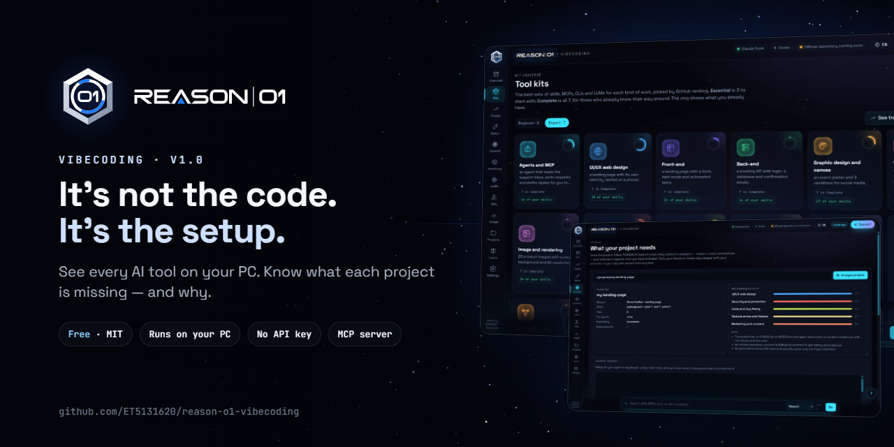</p>

<h1 align="center">REASON O1 / VibeCoding</h1>

<p align="center"><b>A living map of your AI ecosystem.</b><br>See everything installed on your PC — Claude Code, Codex, Cursor, ChatGPT, Ollama, skills, MCP servers, CLIs, local models — and find out what each project is missing, and why.</p>

<p align="center">
  <a href="https://github.com/ET5131620/reason-o1-vibecoding/releases/latest"></a>
  <a href="LICENSE"></a>
  
  
  
  <a href="https://github.com/ET5131620/reason-o1-vibecoding/stargazers"></a>
</p>

<h3 align="center">
  <a href="https://github.com/ET5131620/reason-o1-vibecoding/archive/refs/tags/v1.0.0.zip">⬇ Download v1.0 (ZIP)</a> &nbsp;·&nbsp; <a href="https://et5131620.github.io/reason-o1-vibecoding/">Website &amp; film</a> &nbsp;·&nbsp; <a href="README.pt.md">Português</a>
</h3>

<p align="center">Free and open source (MIT) · English, Português, Français, Español · A thank-you to the open source community and an early look at <b>REASON ONE</b>, launching mid-December.</p>

---

## Why it was created

Most AI projects don't fail because of the code. They fail at the **setup**: too many tools, models, skills and MCP servers, and nobody tells you which ones you already have, which ones the project needs, and which ones just burn tokens. You install the wrong thing, the agent starts without context, and an afternoon goes on configuration.

REASON O1 fixes that first step. It runs on your PC, reads what is there, and tells you — in plain words — what fits each project, what is missing and why. **Set up first, then code.**

## Advantages

- 🔍 **Everything in one place** — every AI app, skill, MCP server, CLI, local model and git project on your PC, found automatically.
- 🧭 **Know what each project is missing** — the Council reads a project and lists the kits, skills, MCPs and CLIs it needs, marking what you have and what you don't.
- 🧰 **18 ready-made kits** — from agents and web design to video, security and data. *Essential* (3 tools) for beginners, *Complete* (7) for experts, ranked by GitHub stars, with what each tool does and why it's there.
- 💸 **Fewer errors, fewer tokens** — the right tool and model for the job, plus token usage by day, project and model.
- 🧑‍🏫 **Made for learning** — animated explanations of LLM, MCP, CLI, skill, agent, API and RAG, and the free official courses.
- 🤝 **Talks to your agent** — it is also an MCP server, so Claude Code or Codex know your setup. No API key, your own account.
- 🔒 **Private and safe** — runs on `127.0.0.1`, reads only names, counts and dates, and **never installs or runs anything by itself**.
- 🆓 **Free, MIT, zero dependencies** — Python standard library only. Download, double-click, done.

## How it works

### 1 · It maps your PC

Every time it opens it scans your machine and draws the map: apps, skills, MCP servers, CLIs, models, agents and projects.

<p align="center">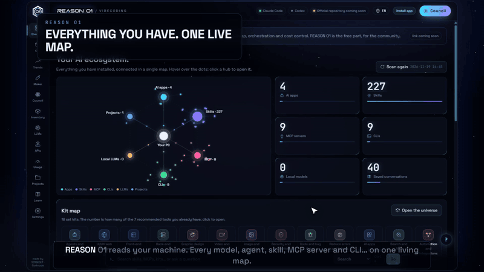</p>

### 2 · Pick a kit for the kind of work

18 kits, each with an Essential and a Complete set. The ring shows how much of it you already have.

<p align="center">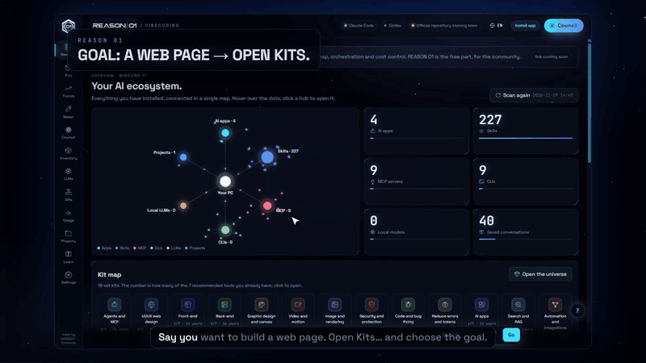</p>

### 3 · See what you have, what's missing — and the steps

Every tool says what it does, why it's in the kit, its stars and licence, and whether **you have it** or it's **missing**. Then a step-by-step to set it up, with your yes at every install.

<p align="center">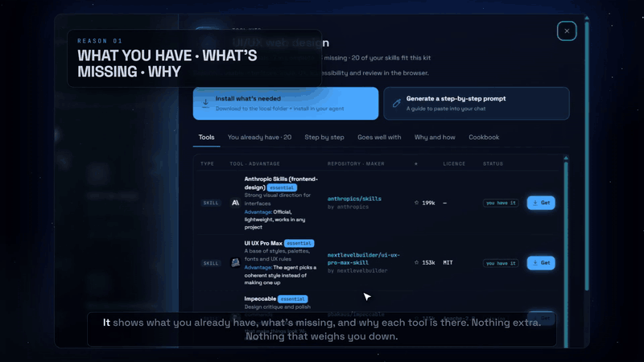</p>

### 4 · Ask the Council about a project

Point it at a project folder. It reads it (read-only), builds a passport — mission, stack, connections — and ranks the kits it needs.

<p align="center">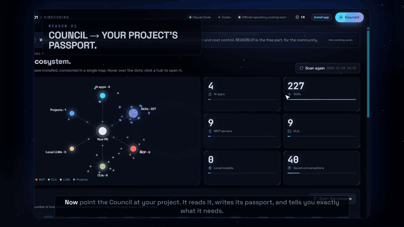</p>

### 5 · Follow what people are using now

Rising GitHub repos, Hacker News and Reddit discussions, and the tools that show up together — from public sources, no key.

<p align="center">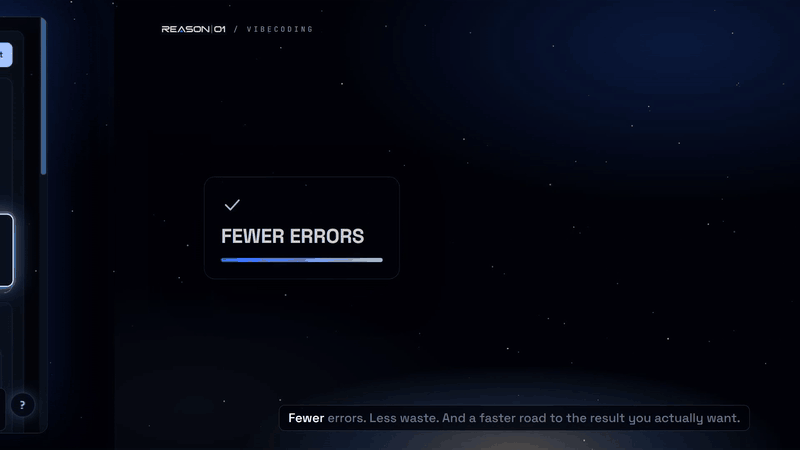</p>

## Screenshots

| | |
|---|---|
| 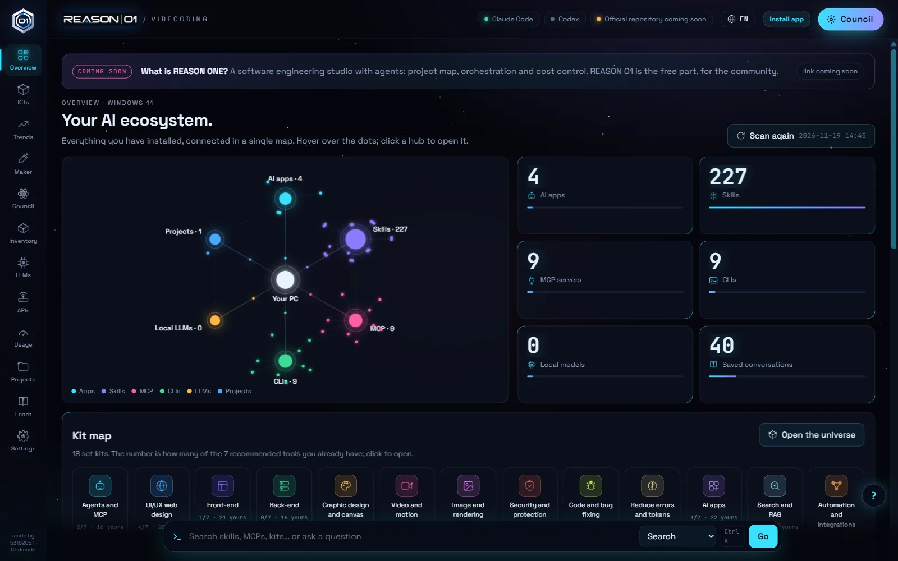<br><sub><b>Overview</b> — your whole AI setup at a glance</sub> | 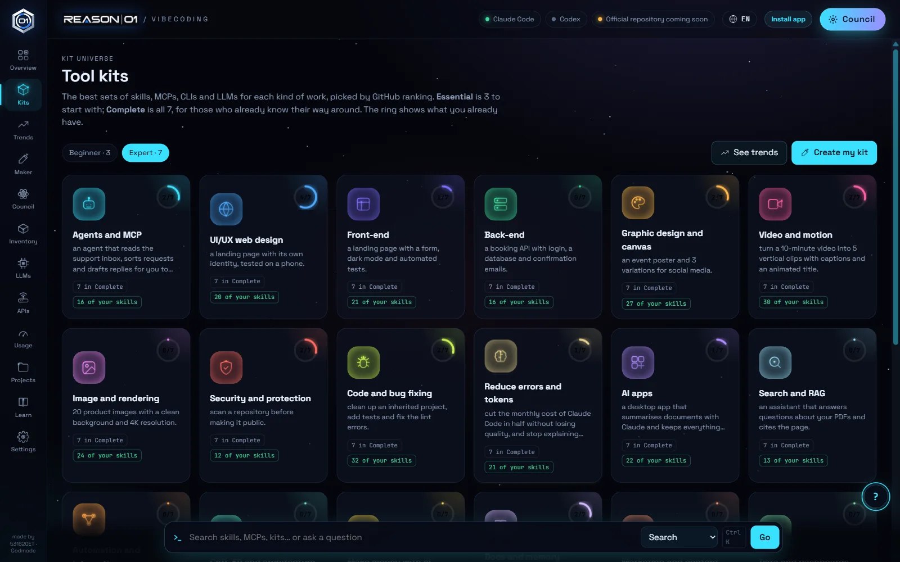<br><sub><b>Kits</b> — 18 areas, Essential or Complete</sub> |
| 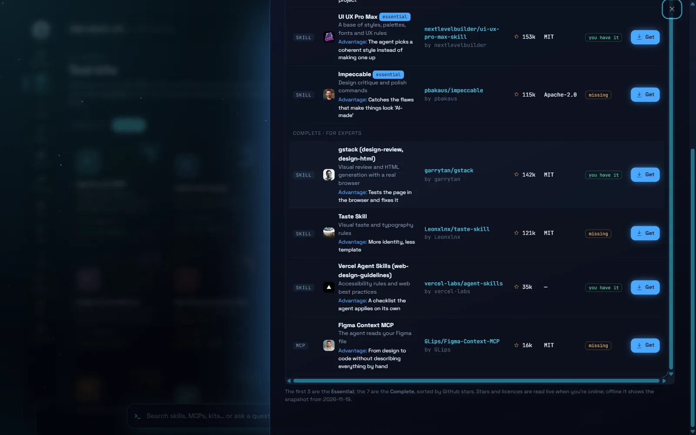<br><sub><b>A kit</b> — have it / missing, stars, licence, Get</sub> | 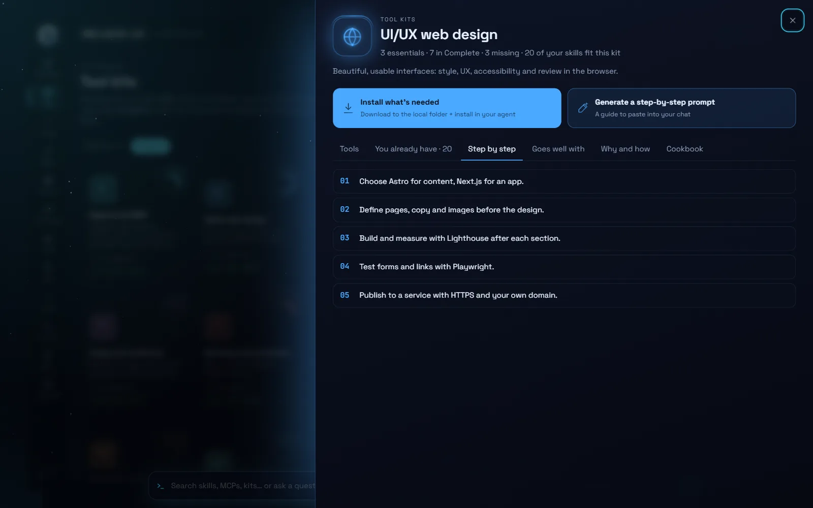<br><sub><b>Step by step</b> — set it up with your agent</sub> |
| 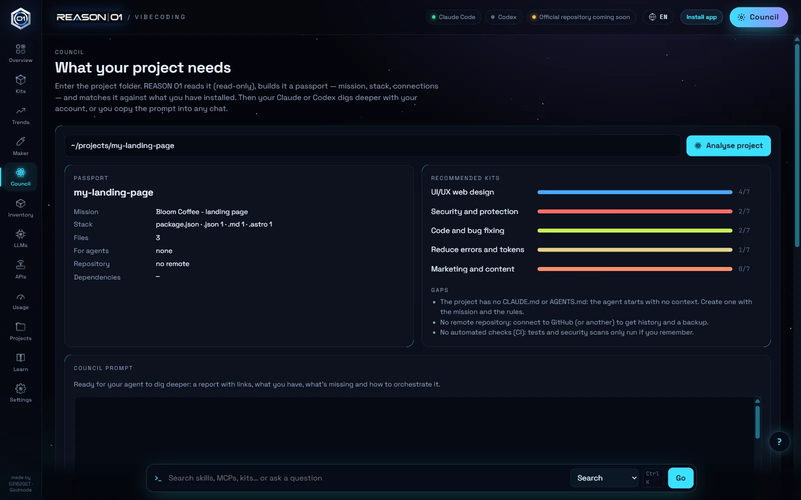<br><sub><b>Council</b> — what your project needs</sub> | 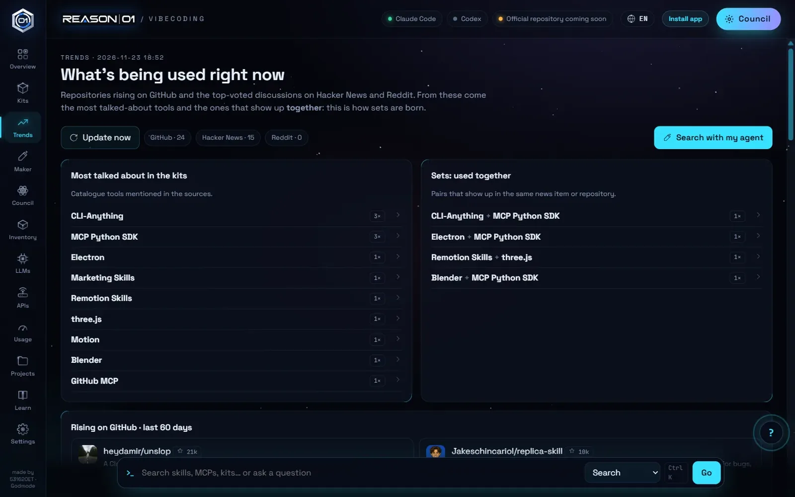<br><sub><b>Trends</b> — what's rising right now</sub> |
| 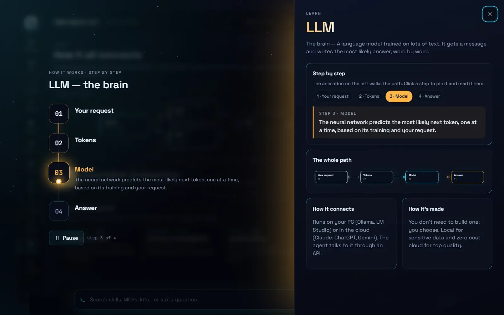<br><sub><b>Learn</b> — the concepts, animated</sub> | <a href="https://et5131620.github.io/reason-o1-vibecoding/"></a><br><sub><b>Website</b> — watch the 70-second film</sub> |

## Everything it does

| | |
|---|---|
| **Automatic inventory** | Every time it opens it scans your PC: AI apps, skills, MCP servers, CLIs, local models, agents, git projects and saved conversations. It only reads names, counts and dates. |
| **Tool kits** | 18 kits — agents & MCP, UI/UX web design, front-end, back-end, graphic design, video, image, security, code, **fewer errors & tokens**, AI apps, research & RAG, automation, CAD/3D, monetising, docs & memory, marketing, data. Each has an **Essential** set (3, for beginners) and a **Complete** set (7, for experts), ranked by GitHub stars, with what each tool does, why it's there and which tools it **pairs well with**. It also shows the skills you already have for that area. |
| **Get it** | Every tool has a visible download button: GitHub, ZIP, `git clone`, or a ready prompt so your own agent reads the README, checks the licence and installs it — with your yes. |
| **Trends** | What people are using right now, from public sources with no key: rising GitHub repos, Hacker News and Reddit discussions, the most-mentioned tools and the ones that appear together. Click anything for a preview before leaving the app. For TikTok, Instagram and Facebook it writes the research prompt for your agent. |
| **Council** | Reads a project (read-only), builds a passport — mission, stack, connections — and tells you which kits, skills, MCPs and CLIs it needs, with what you have and what's missing. |
| **Usage** | How many tokens you spend, where and on what: Claude Code and Codex by day, project and model, the Codex rate-limit window, your OpenRouter balance and OmniRoute status. Off until you turn it on; only numbers are read, never conversation content. |
| **Maker** | Build your own kit from a goal, keep a prompt library, and scaffold new skills. |
| **Learn** | What an LLM, MCP, CLI, skill, agent, API and RAG are — with animated, clickable explanations — plus links to the free official courses from Anthropic and OpenAI. |
| **APIs & router** | Free APIs and a step-by-step guide to OmniRoute: one local address for many models, connected to Claude Code and Codex. |
| **Connects to your agent** | It is also an MCP server: your Claude Code or Codex gets to know your inventory and the kits, using the account you already have. No API key. |
| **Installable** | Runs as an app (PWA) with its own window and icon. Updates itself from this repository, with a backup of the previous version. |

## Get started

You need Python 3.10 or newer. Nothing else to install — it uses only the standard library.

**Easiest:** [download the ZIP](https://github.com/ET5131620/reason-o1-vibecoding/archive/refs/tags/v1.0.0.zip), unzip it and double-click `ARRANCAR.bat` (Windows). On macOS or Linux, open a terminal in the folder and run `python3 reason_o1.py`.

**With git:**

```bash
git clone https://github.com/ET5131620/reason-o1-vibecoding.git
cd reason-o1-vibecoding
python reason_o1.py
```

On Windows you can also double-click `ARRANCAR.bat`. The dashboard opens at `http://127.0.0.1:8731`. The first launch walks you through a short setup: name (optional), folders, what it may read, the responsibility terms, a starter pack and free courses.

### Connect to Claude Code

```bash
claude mcp add reason-o1 --scope user -- python /path/to/reason_o1.py mcp
```

### Connect to Codex (`~/.codex/config.toml`)

```toml
[mcp_servers.reason-o1]
command = "python"
args = ["/path/to/reason_o1.py", "mcp"]
```

12 MCP tools:

- **Read:** `o1_inventario`, `o1_kits`, `o1_kit`, `o1_catalogo_pesquisar`, `o1_passaporte`, `o1_tendencias`, `o1_kit_criar`.
- **Generate:** `o1_prompt_gerar` returns the prompt and writes nothing.
- **Write** (only inside the REASON O1 folders): `o1_guardar_relatorio`, `o1_kit_guardar`, `o1_prompts` (list and save), `o1_skill_criar`.

## Privacy and safety

- Runs only on `127.0.0.1`. Every API call carries a fresh session token and the `Host` header is checked.
- Never reads keys, environment variables, MCP arguments or conversation content. Git URLs lose their credentials before they are shown.
- "Ask Claude/Codex" uses your own CLI in read-only mode and asks first, because it counts towards your limits.
- **The program never runs downloaded code.** "Install what's needed" gives you the commands and a request for your agent, which asks for your yes.
- It only advises. What you install, and its security, is your responsibility — see [TERMS.md](TERMS.md) (accepted on first launch; [Portuguese original](TERMOS.md)).
- Your settings live in `~/.reason-o1/`.

## Languages

The dashboard speaks English, Portuguese, French and Spanish (language button at the top). Text is written in Portuguese in the code and translated in the browser from `ui/i18n/<lang>.json`.

If you change or add text to the interface, the kits or the server messages, run before publishing:

```bash
python tools/i18n.py            # fails and lists what is missing
python tools/i18n.py missing    # writes ui/i18n/_missing.<lang>.json to translate
```

A release only ships with all four languages complete.

## Structure

```
reason_o1.py        local server + MCP entry + scan
o1/core.py          inventory, passport, council
o1/mcp_server.py    MCP server (stdio)
o1/studio.py        kits you already cover, kit maker, prompts, skills, Cookbook
o1/trends.py        trends (GitHub, Hacker News, Reddit)
o1/usage.py         token usage from local Claude Code / Codex logs, provider balances
o1/updater.py       self-update from the official repository (backup, zip-slip protection)
o1/about.py         version, credits, official repository
data/kits.json      the 18 kits (3 + 7), pairs, combinations and the Cookbook
data/catalog.json   LLMs, runtimes, agents, skill and MCP sources
ui/index.html       the dashboard
ui/i18n/            EN / FR / ES translations (Portuguese is the source)
tools/i18n.py       four-language check
docs/               the website (GitHub Pages)
```

## REASON ONE

REASON O1 is a free head start. **REASON ONE** — an agent-driven software engineering studio — launches in **mid-December** as a closed-source product. Everything you set up here (kits, skills, MCP, habits) carries over.

## Thanks

To everyone who shares code in the open: I learned a lot from you, and this is my way of giving back. If you build something with it, say you started with REASON O1 — it helps others find it.

Issues and pull requests are welcome.

## Made by

**531620ET · Godmode**

The kits point to third-party projects, each with its own licence. Always read the README and the licence before installing. Licensed under [MIT](LICENSE).
