<p align="center">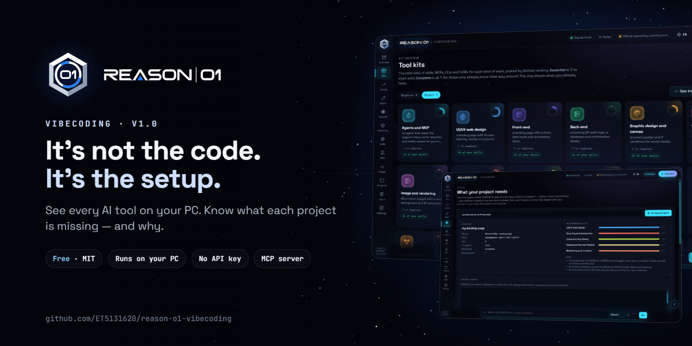</p>

<h1 align="center">REASON O1 / VibeCoding</h1>

<p align="center"><b>Um mapa vivo do teu ecossistema de IA.</b><br>Vê tudo o que tens instalado no PC — Claude Code, Codex, Cursor, ChatGPT, Ollama, skills, servidores MCP, CLIs, modelos locais — e descobre o que falta a cada projeto, e porquê.</p>

<p align="center">
  <a href="https://github.com/ET5131620/reason-o1-vibecoding/releases/latest"></a>
  <a href="LICENSE"></a>
  
  
  
  <a href="https://github.com/ET5131620/reason-o1-vibecoding/stargazers"></a>
</p>

<h3 align="center">
  <a href="https://github.com/ET5131620/reason-o1-vibecoding/archive/refs/tags/v1.0.0.zip">⬇ Descarregar a v1.0 (ZIP)</a> &nbsp;·&nbsp; <a href="https://et5131620.github.io/reason-o1-vibecoding/">Site e filme</a> &nbsp;·&nbsp; <a href="README.md">English</a>
</h3>

<p align="center">Grátis e de código aberto (MIT) · Português, English, Français, Español · Um obrigado à comunidade open source e uma antevisão do <b>REASON ONE</b>, que chega em meados de dezembro.</p>

---

## Porque foi criado

A maior parte dos projetos com IA não falha por causa do código. Falha na **configuração**: ferramentas, modelos, skills e servidores MCP a mais, e ninguém te diz quais já tens, quais o projeto precisa e quais só gastam tokens. Instalas a coisa errada, o agente arranca sem contexto e uma tarde vai-se em configuração.

O REASON O1 resolve esse primeiro passo. Corre no teu PC, lê o que lá está e diz-te, em palavras simples, o que serve a cada projeto, o que falta e porquê. **Primeiro a configuração, depois o código.**

## Vantagens

- 🔍 **Tudo num só sítio** — cada app de IA, skill, servidor MCP, CLI, modelo local e projeto git do teu PC, encontrados sozinhos.
- 🧭 **Sabes o que falta a cada projeto** — o Conselho lê o projeto e lista os kits, skills, MCPs e CLIs de que precisa, com o que já tens e o que não tens.
- 🧰 **18 kits prontos** — de agentes e web design a vídeo, segurança e dados. *Essencial* (3 ferramentas) para quem começa, *Completo* (7) para quem já sabe, ordenados pelas estrelas no GitHub, com o que cada ferramenta faz e porque está lá.
- 💸 **Menos erros, menos tokens** — a ferramenta e o modelo certos para o trabalho, e o consumo de tokens por dia, projeto e modelo.
- 🧑‍🏫 **Feito para aprender** — explicações animadas de LLM, MCP, CLI, skill, agente, API e RAG, e os cursos oficiais gratuitos.
- 🤝 **Fala com o teu agente** — é também um servidor MCP: o Claude Code ou o Codex passam a conhecer a tua configuração. Sem chave de API, com a tua conta.
- 🔒 **Privado e seguro** — corre em `127.0.0.1`, lê só nomes, contagens e datas, e **nunca instala nem corre nada sozinho**.
- 🆓 **Grátis, MIT, sem dependências** — só a biblioteca padrão do Python. Descarregar, duplo clique, pronto.

## Como funciona

### 1 · Mapeia o teu PC

Sempre que abre, varre a máquina e desenha o mapa: apps, skills, servidores MCP, CLIs, modelos, agentes e projetos.

<p align="center">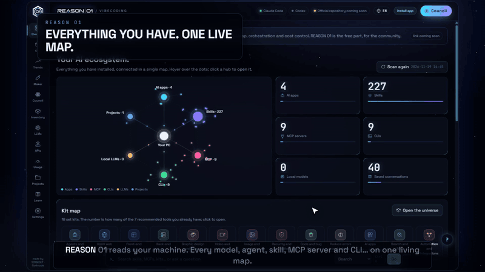</p>

### 2 · Escolhe um kit para o tipo de trabalho

18 kits, cada um com o conjunto Essencial e o Completo. O anel mostra quanto dele já tens.

<p align="center">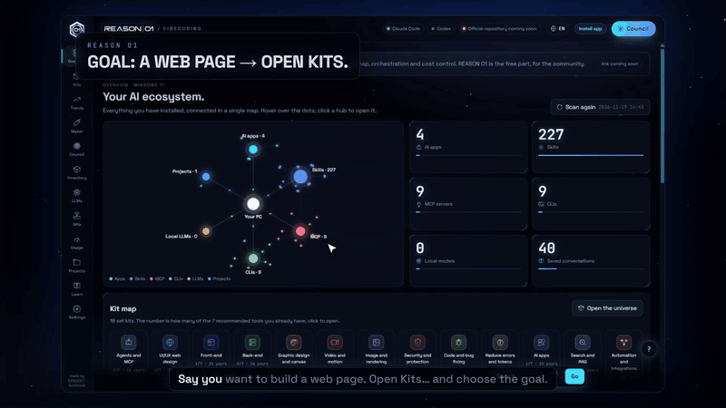</p>

### 3 · Vê o que tens, o que falta — e os passos

Cada ferramenta diz o que faz, porque está no kit, as estrelas e a licença, e se **já a tens** ou se **falta**. Depois, um passo a passo para a configurar, com o teu sim em cada instalação.

<p align="center">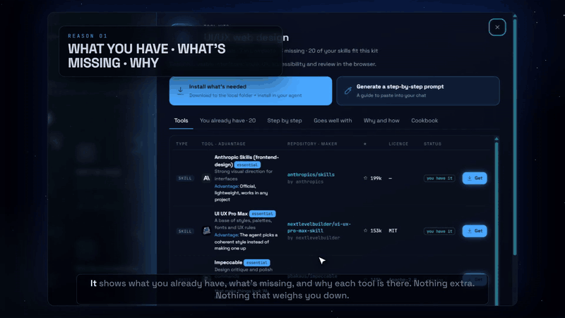</p>

### 4 · Pede ao Conselho que analise um projeto

Indica a pasta do projeto. Ele lê-a (só leitura), faz o passaporte — missão, stack, ligações — e ordena os kits de que precisa.

<p align="center">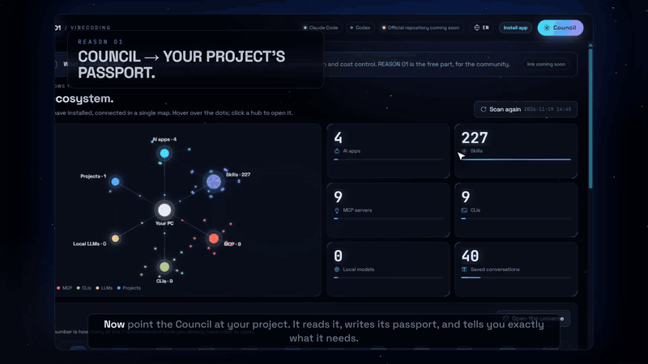</p>

### 5 · Acompanha o que se está a usar agora

Repositórios a subir no GitHub, discussões do Hacker News e do Reddit, e as ferramentas que aparecem juntas — de fontes públicas, sem chave.

<p align="center">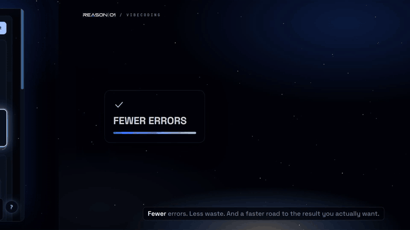</p>

> As imagens mostram a app em inglês; dentro dela escolhes o português no botão de idioma.

## Capturas

| | |
|---|---|
| 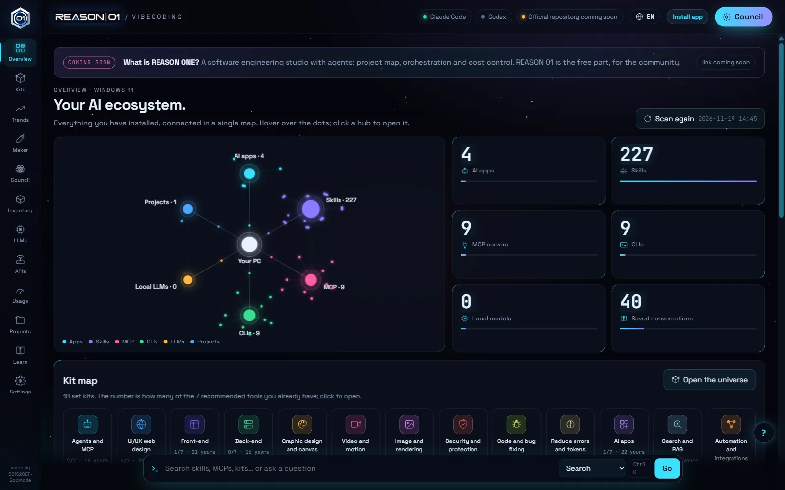<br><sub><b>Visão geral</b> — a tua configuração de IA de relance</sub> | 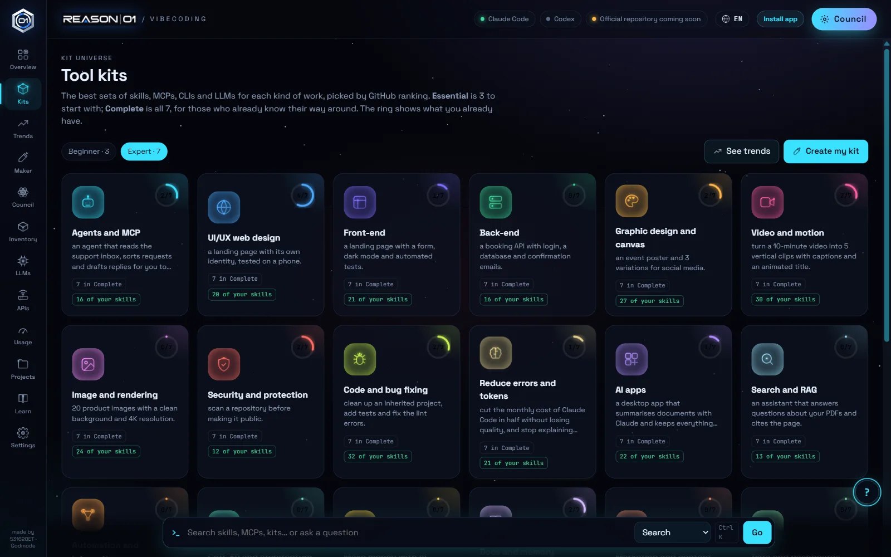<br><sub><b>Kits</b> — 18 áreas, Essencial ou Completo</sub> |
| 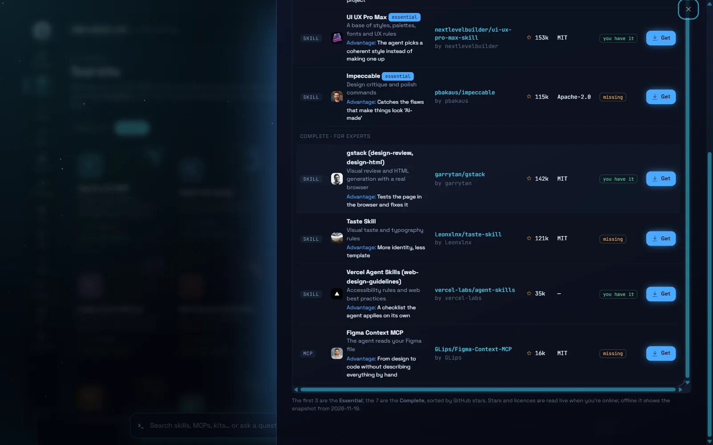<br><sub><b>Um kit</b> — tens / falta, estrelas, licença, obter</sub> | 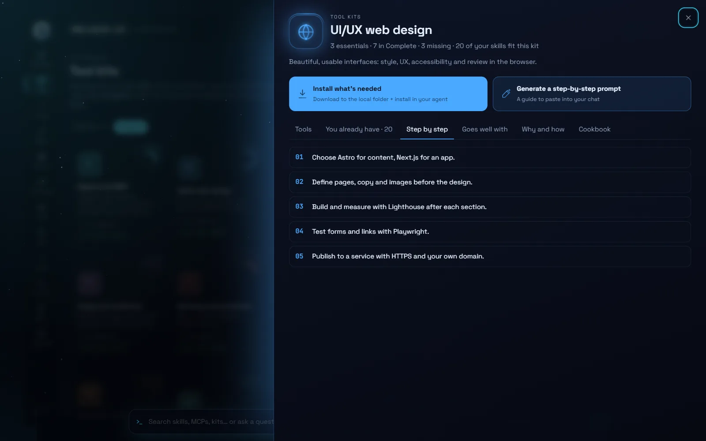<br><sub><b>Passo a passo</b> — configura com o teu agente</sub> |
| 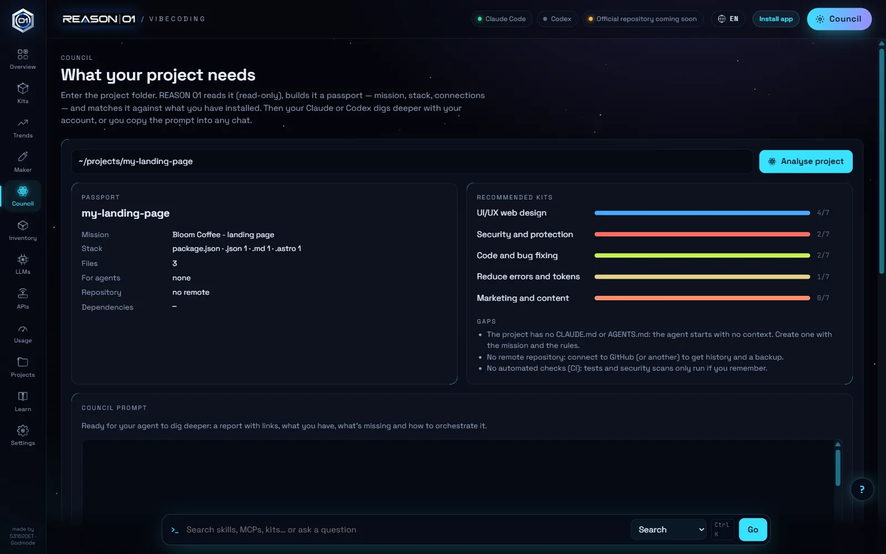<br><sub><b>Conselho</b> — o que o teu projeto precisa</sub> | 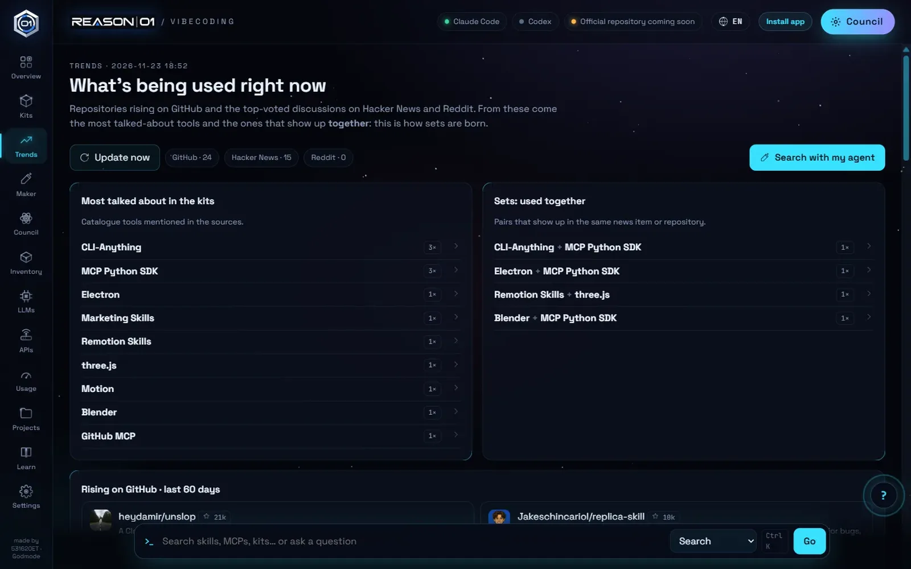<br><sub><b>Tendências</b> — o que está a subir agora</sub> |
| 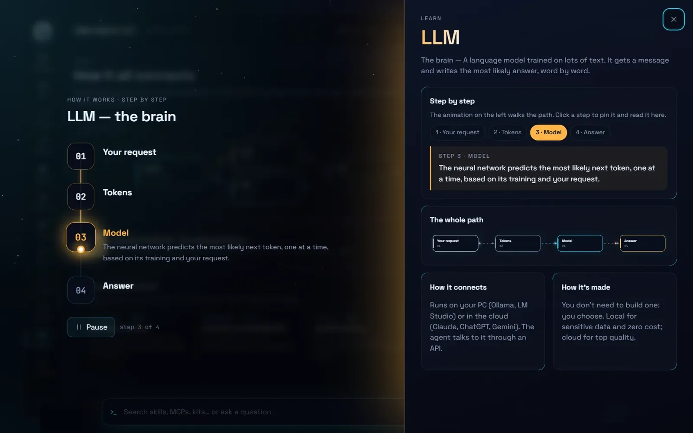<br><sub><b>Aprender</b> — os conceitos, animados</sub> | <a href="https://et5131620.github.io/reason-o1-vibecoding/"></a><br><sub><b>Site</b> — vê o filme de 70 segundos</sub> |

## Tudo o que faz

| | |
|---|---|
| **Inventário automático** | Sempre que abre, varre o PC: apps de IA, skills, servidores MCP, CLIs, modelos locais, agentes, projetos git e conversas guardadas. Lê só nomes, contagens e datas. |
| **Kit de conjuntos** | 18 kits: agentes e MCP, web design UI/UX, front-end, back-end, design gráfico e canvas, vídeo, imagem, segurança, código, **reduzir erros e tokens**, apps com IA, pesquisa e RAG, automação, CAD/3D, monetizar, docs e memória, marketing, dados. Cada um tem o conjunto **Essencial** (3, para principiante) e o **Completo** (7, para expert), ordenados pelas estrelas no GitHub, com o que faz e a vantagem de cada ferramenta. Mostra também as skills que **já tens** para essa área. Dois botões: **instalar o necessário** e **gerar prompt passo a passo**. |
| **Tendências** | O que se está a usar agora, de fontes públicas e sem chave: repositórios a subir no GitHub, discussões do Hacker News e do Reddit, as ferramentas mais faladas e as que aparecem juntas. Para o TikTok, o Instagram e o Facebook gera o pedido de pesquisa para o teu agente. |
| **Criador** | Monta o teu kit a partir de um objetivo e guarda-o em `09_KITS`. Tem uma biblioteca de prompts em `07_PROMPTS` e cria o esqueleto de skills novas em `01_SKILLS`. |
| **Claude Cookbook** | As receitas oficiais da Anthropic como base de exemplos: sugeridas no primeiro arranque e ligadas a cada kit. |
| **Conselho** | Lê um projeto (só leitura), faz-lhe um passaporte — missão, stack, ligações — e diz que kits, skills, MCPs e CLIs ele precisa, com o que já tens e o que falta. |
| **Liga-se ao teu agente** | É também um servidor MCP: o teu Claude Code ou Codex passa a conhecer o teu inventário e os kits, com a conta que já tens. Sem chave de API. |
| **Aprender** | O que é um LLM, MCP, CLI, skill, agente, API e RAG — e um assistente para criar a tua primeira skill. |
| **APIs e router** | O que é um router de APIs, APIs grátis e o passo a passo com o OmniRoute: um só endereço local para muitos modelos, ligado ao Claude Code e ao Codex. |
| **Sempre atualizado** | Ao abrir (e a cada 6 h) procura a versão nova no repositório oficial, instala-a com cópia de segurança da anterior e reinicia. Os kits sincronizam mesmo entre versões. Pode ser desligado nas Definições. |

## Começar

Precisas do Python 3.10 ou mais recente. Não há nada para instalar: só a biblioteca padrão.

**O mais simples:** [descarrega o ZIP](https://github.com/ET5131620/reason-o1-vibecoding/archive/refs/tags/v1.0.0.zip), descompacta e dá duplo clique em `ARRANCAR.bat` (Windows). No macOS ou Linux, abre um terminal na pasta e corre `python3 reason_o1.py`.

**Pela linha de comandos:**

```bash
python reason_o1.py
```

No Windows também podes dar duplo clique em `ARRANCAR.bat`. O painel abre em `http://127.0.0.1:8731`.

### Ligar ao Claude Code

```bash
claude mcp add reason-o1 --scope user -- python /caminho/para/reason_o1.py mcp
```

### Ligar ao Codex (`~/.codex/config.toml`)

```toml
[mcp_servers.reason-o1]
command = "python"
args = ["/caminho/para/reason_o1.py", "mcp"]
```

Ferramentas MCP (12):

- **Ler:** `o1_inventario`, `o1_kits`, `o1_kit`, `o1_catalogo_pesquisar`, `o1_passaporte`, `o1_tendencias`, `o1_kit_criar`.
- **Gerar:** `o1_prompt_gerar` devolve o prompt e não grava nada.
- **Escrever** (só nas pastas do REASON O1): `o1_guardar_relatorio`, `o1_kit_guardar`, `o1_prompts` (listar e guardar), `o1_skill_criar`.

Com o MCP ligado, o Claude Code ou o Codex pedem ajuda ao programa para escolher o melhor conjunto, gerar e guardar prompts e criar skills.

## Privacidade e segurança

- Corre só em `127.0.0.1`. Cada pedido à API leva um token de sessão novo e o cabeçalho `Host` é verificado.
- Nunca lê chaves, variáveis de ambiente, argumentos de MCP nem o conteúdo das conversas. Os URLs git perdem as credenciais antes de serem mostrados.
- "Pedir ao Claude/Codex" usa o teu próprio CLI em modo só leitura e pede confirmação antes, porque conta para os teus limites.
- O programa nunca executa código descarregado. "Instalar o necessário" dá-te os comandos e um pedido para o teu agente, que pede o teu sim.
- As tuas definições ficam em `~/.reason-o1/`.

## Estrutura

```
reason_o1.py        servidor local + entrada MCP + scan
o1/core.py          inventário, passaporte, conselho
o1/mcp_server.py    servidor MCP (stdio)
o1/studio.py        o que já tens por kit, criador de kits, prompts, skills, Cookbook
o1/trends.py        tendências (GitHub, Hacker News, Reddit)
o1/updater.py       atualização a partir do repositório oficial (cópia de segurança, proteção zip-slip)
o1/about.py         versão, créditos, repositório oficial
data/kits.json      os 18 kits (3 + 7), as combinações e o Cookbook
data/catalog.json   LLMs, motores, agentes, fontes de skills e MCP
data/gh_snapshot.json  estrelas e datas para funcionar offline
ui/index.html       o painel
ui/i18n/            traduções EN / FR / ES (o português é a fonte)
tools/i18n.py       verificação das quatro línguas
```

## Línguas

O painel fala português, inglês, francês e espanhol (botão de idioma no topo). O texto é escrito em português no código e traduzido no browser a partir de `ui/i18n/<língua>.json`.

Quem mudar ou acrescentar texto à interface, aos kits ou às mensagens do servidor corre antes de publicar:

```
python tools/i18n.py            # falha e lista o que falta traduzir
python tools/i18n.py missing    # escreve ui/i18n/_missing.<língua>.json para traduzir
```

Uma versão só sai com as quatro línguas completas.

## Criado por

**531620ET · Godmode** — GitHub: *link por confirmar*

Os kits apontam para projetos de terceiros, cada um com a sua licença. Lê sempre o README e a licença antes de instalar.
